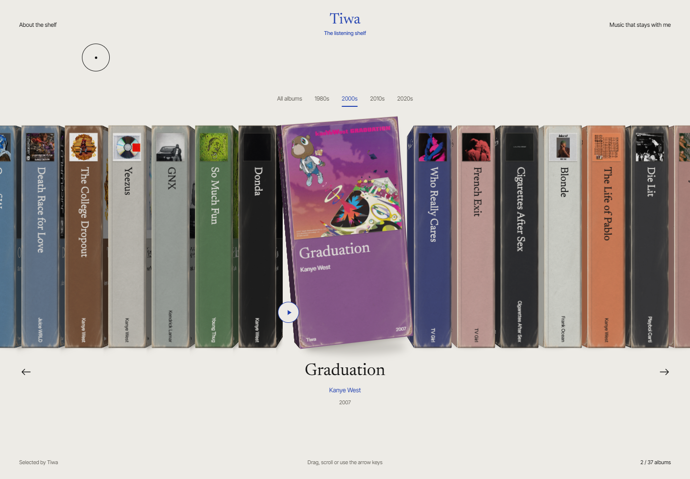

# The Listening Shelf

The albums that inspire me, collected in one place

The Listening Shelf is Tiwa’s personal music collection: 37 albums and EPs presented as a shelf of worn VHS sleeves. It’s a place to browse the artwork, revisit a favourite and discover something new to listen to.

The collection opens on *Donda* and continues in a personal order through releases including *Graduation*, *Blonde*, *French Exit*, *Die Lit* and *Depression Cherry*. Worn paper, scuffed corners and gentle movement give each sleeve the feel of something you could pull off a real shelf.

## Take a look around

- **Browse the shelf** — drag with your mouse, swipe on your phone or use the arrows to move between albums
- **Explore by decade** — jump to music from different years
- **Open an album** — select a sleeve for a closer look at its original cover and release details
- **Keep listening** — follow the album’s listening link when something catches your ear

You can also browse with the left and right arrow keys, press Enter to open a selected sleeve and Escape to return. Reduced-motion preferences are supported.

## The music

Kanye West, TV Girl, Cigarettes After Sex, Frank Ocean, Playboi Carti, The Smiths, Beach House, Kendrick Lamar and more — brought together by the music that inspires Tiwa.

Album artwork belongs to its respective artists and rights holders. [View the artwork credits](ARTWORK-SOURCES.md).
